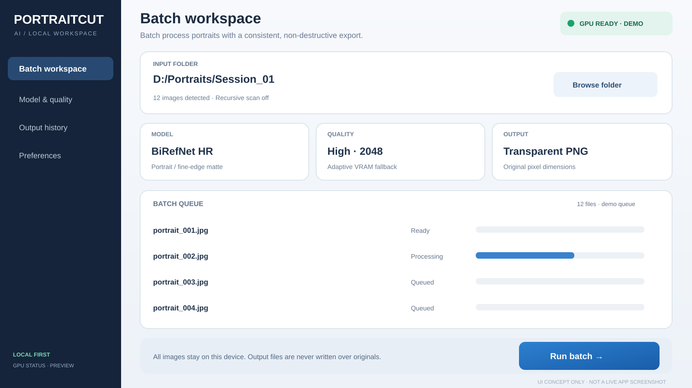
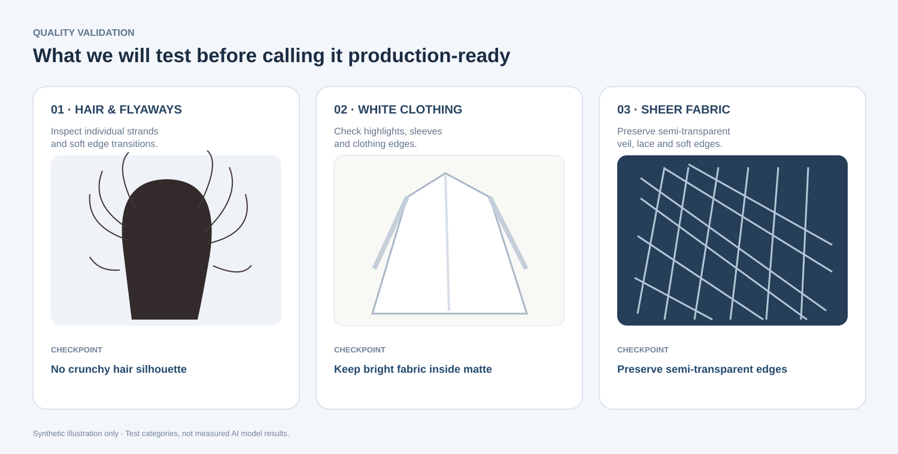

# PortraitCut AI

[**English**](README.md) · [简体中文](README.zh-CN.md)

**A local-first Windows desktop application for batch portrait cutout with NVIDIA GPU acceleration.**

> **Status: MVP Alpha.** This is an early developer release, not a Photoshop replacement. CUDA inference, output quality on real portraits, and packaged execution still require validation on a physical Windows + RTX 4070 system.

*Interface concept only — not a screenshot of the running application.*

## Features

- Batch import from folders, with optional recursive scanning.
- Local portrait matting with the pinned BiRefNet-HR-matting model.
- NVIDIA CUDA + FP16 preference, with lower-resolution retries after GPU out-of-memory errors.
- Transparent PNG export using the source image RGB and the predicted alpha matte.
- Sequential inference to limit VRAM use; per-file failures do not stop the remaining batch.
- Collision-safe output naming and progress reporting.

## Preview

*Synthetic illustration showing the intended transparent-PNG composition; not an AI inference result.*

*Illustrative test categories: fine hair, white clothing on a light background, and sheer fabric. These are not measured model results.*

## Compatibility baseline

| Component | Version / target |
|---|---|
| OS | Windows 10/11 x64 |
| Python | 3.11 x64 |
| PyTorch / torchvision | 2.5.1 / 0.20.1 |
| CUDA runtime | 12.1 PyTorch wheel; NVIDIA driver required |
| Transformers | 5.0.0 |
| huggingface-hub | >=1.0.0,<2 |
| NumPy | 1.26.4 |

These are pinned compatibility choices for the current BiRefNet adapter, not a statement that they are the latest available versions. See `requirements*.txt` before changing the environment.

The adapter loads the model repository with `trust_remote_code=True` and pins model-code revision `5d6b6f8adcb5b417c871b1d84ceaae9871355b7f`. This means Python code from that upstream model revision is executed locally. Review the pinned upstream code before first use.

References: [BiRefNet-HR model card](https://huggingface.co/ZhengPeng7/BiRefNet_HR-matting) · [Pinned model-code revision](https://huggingface.co/ZhengPeng7/BiRefNet_HR-matting/tree/5d6b6f8adcb5b417c871b1d84ceaae9871355b7f) · [PyTorch installation selector](https://pytorch.org/get-started/locally/)

## Install and run (Windows)

1. Install 64-bit Python 3.11 and a current NVIDIA driver.
2. Open PowerShell in the repository root and run:

~~~powershell
Set-ExecutionPolicy -Scope Process Bypass
.\scripts\install_windows.ps1
~~~

3. Launch the application:

~~~powershell
.\.venv\Scripts\python.exe -m app.main
~~~

4. Check CUDA availability:

~~~powershell
.\.venv\Scripts\python.exe scripts\verify_gpu.py
~~~

The first model load requires an internet connection to download model files. After they are cached, image inference runs locally.

## Build a Windows application folder

Run `scripts/build_windows.ps1` on Windows. The output is `dist/PortraitCutAI/`; keep the full folder together. The application and Python libraries are bundled, but the NVIDIA driver remains a system prerequisite and model files are downloaded on first use. This is not yet a fully offline installer.

## Batch safeguards

- Maximum image size: **50 megapixels** per file.
- Maximum discovered batch size: **10,000 images**.
- Inference is sequential, one image at a time.
- Existing output files are not overwritten; a suffix is added when names collide.
- Cancellation takes effect after the current image finishes.
- These are protective limits, not measured performance or throughput guarantees.

## Tests

~~~powershell
.\.venv\Scripts\python.exe -m pip install -r requirements-dev.txt
.\.venv\Scripts\python.exe -m pytest -q
~~~

CI tests cover CPU-safe code paths. Passing CI does not prove CUDA performance, visual quality on all image types, or packaged application behavior on every PC.

## Repository layout

~~~text
app/          Desktop application, batch pipeline and model adapter
scripts/      Windows setup, GPU verification and packaging
tests/        CPU-safe regression tests
docs/         Interface and quality-test concept illustrations
models/       Model download and license notes (weights are not committed)
~~~

The separately supplied white-background JavaScript utility is not part of this repository or the current application.

## Privacy

PortraitCut AI performs image inference on the user's device. The application code does not implement an image-upload service or remote inference endpoint. On first use, the application contacts Hugging Face to obtain the model files; those files are then cached locally.

The model adapter executes the pinned upstream model code locally. Review the model revision and third-party dependencies before using the application with sensitive material.

## Security reports

Please do not post credentials, private images, or other sensitive material in public issues. See [SECURITY.md](SECURITY.md) for vulnerability-reporting guidance and [CONTRIBUTING.md](CONTRIBUTING.md) for maintainer practices.

## License

Original PortraitCut AI project code is licensed under the **Apache License 2.0**; see [LICENSE](LICENSE). Third-party model code, model weights, Python packages and Qt components retain their own licenses. See [THIRD_PARTY_NOTICES.md](THIRD_PARTY_NOTICES.md).

The current PyInstaller script is a development packaging baseline, not a completed third-party license-compliance package. Review the exact Qt modules and redistribution obligations before distributing binaries. The separate white-background JavaScript utility is not included and is not covered by this repository's license.
