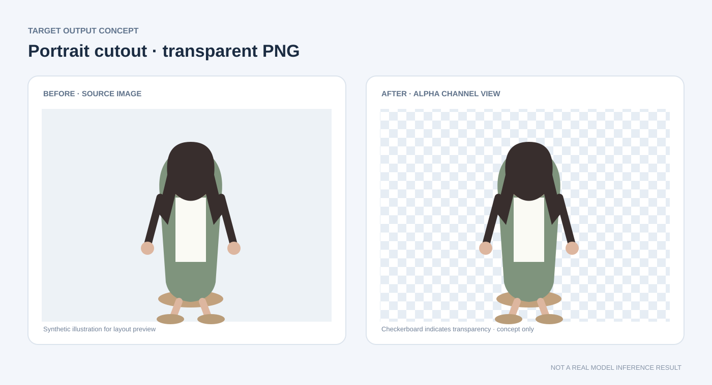

# PortraitCut AI

[**English**](README.md) · [简体中文](README.zh-CN.md)

**Local-first Windows desktop app for batch portrait cutout with NVIDIA GPU acceleration.**

> **Status: MVP Alpha.** This is a developer preview, not a finished Photoshop replacement. CUDA runtime, visual quality and packaging still need validation on a physical Windows + RTX 4070 machine.

*GUI concept only — a design preview, not a screenshot of the running application.*

## What it is designed to do

- Import a folder of portraits (optionally include subfolders).
- Run BiRefNet-HR-matting locally, one image at a time.
- Prefer NVIDIA CUDA + FP16; retry lower model input sizes after CUDA out-of-memory errors.
- Preserve source RGB and use the predicted matte as the PNG alpha channel.
- Export transparent PNGs without overwriting original files.
- Continue after per-image failures and report every item.
- Keep image processing local. The model is downloaded to the local Hugging Face cache on first use.

## Visual previews

### Intended transparent PNG composition

*Synthetic illustration only. The checkerboard represents transparency; this is not output from the AI model.*

### Quality validation cases

*Synthetic illustrations showing edge cases to validate: flyaway hair, white clothing against a light background, and sheer fabric. These are evaluation categories, not measured AI results.*

## Current compatibility baseline

| Component | Project baseline | Notes |
|---|---|---|
| OS | Windows 10/11 x64 | Desktop target |
| Python | 3.11 x64 | Packaging baseline |
| PyTorch | 2.5.1 | CUDA 12.1 wheel |
| torchvision | 0.20.1 | Matched to PyTorch 2.5.1 |
| CUDA runtime | 12.1 wheel | NVIDIA driver required; separate CUDA Toolkit normally not needed |
| Transformers | 5.0.0 (pinned) | Matches the pinned BiRefNet model-code compatibility fix |
| huggingface-hub | >=1.0.0,<2 | Required by Transformers 5 |
| timm | >=1.0.23 | Required by upstream model code |
| NumPy | 1.26.4 | Kept below NumPy 2 for upstream compatibility |

The BiRefNet-HR-matting model card documents Transformers loading with trust_remote_code=True. This project pins Transformers 5.0.0 and model-code revision 5d6b6f8adcb5b417c871b1d84ceaae9871355b7f to match the upstream Transformers 5.0 compatibility fix. Transformers 5 requires huggingface-hub >=1.0.0; see requirements-ai.txt. Remote model code is executable Python. Review it before first use.

References: [BiRefNet-HR model card](https://huggingface.co/ZhengPeng7/BiRefNet_HR-matting) · [Pinned code revision](https://huggingface.co/ZhengPeng7/BiRefNet_HR-matting/tree/5d6b6f8adcb5b417c871b1d84ceaae9871355b7f) · [PyTorch installer](https://pytorch.org/get-started/locally/) · [PyTorch wheel matrix](https://pytorch.org/get-started/previous-versions/)

The chosen PyTorch / torchvision pair is a conservative compatibility baseline, not a claim that these are the newest packages. Newer versions may work, but should not be substituted silently: run the model smoke test and visual test set before changing the matrix.

## Install from source (Windows)

1. Install 64-bit Python 3.11 and a current NVIDIA driver.
2. Open PowerShell in the repository root.
3. Run:

~~~powershell
Set-ExecutionPolicy -Scope Process Bypass
.\scripts\install_windows.ps1
~~~

4. Start the desktop app:

~~~powershell
.\.venv\Scripts\python.exe -m app.main
~~~

5. Verify CUDA:

~~~powershell
.\.venv\Scripts\python.exe scripts\verify_gpu.py
~~~

The first model load requires network access to download model files. Once cached, inference is local. Do not install a second Python / PyTorch stack into the same environment.

## Build a self-contained Windows folder

Run scripts/build_windows.ps1. The output is dist/PortraitCutAI/. Keep the complete folder together when distributing. The package bundles Python and Python dependencies; the NVIDIA display driver remains a machine prerequisite. Model weights remain in the user's Hugging Face cache and download on first run. Therefore, the current build is **self-contained for application code and Python libraries, but not fully offline on first launch**.

PyInstaller builds are specific to the OS, Python version and architecture. Build on Windows under the intended 64-bit Python version. One-folder mode is used first because it is easier to inspect and debug than a one-file executable.

## Batch safety limits and behavior

- Inference is sequential (one image at a time); no concurrent model copies are created for a batch.
- Maximum input size: **50 megapixels per image**. Oversized or malformed files fail individually and are reported.
- Maximum discovered batch size: **10,000 images**. Split larger jobs into smaller folders.
- Recursive folder scanning is optional.
- Output keeps relative subfolder paths and uses PNG. Existing outputs are not overwritten; a suffix is added on collision.
- CUDA OOM retry order defaults to 2048 → 1792 → 1536 → 1280 → 1024 according to the selected starting quality.
- Cancel stops after the current image's inference returns; it does not interrupt a CUDA kernel mid-operation.
- These are protective software limits, not a measured throughput ceiling. A real maximum-batch stress test requires the target Windows machine.

## Tests

~~~powershell
.\.venv\Scripts\python.exe -m pip install -r requirements-dev.txt
.\.venv\Scripts\python.exe -m pytest -q
~~~

GitHub Actions runs CPU-safe Windows tests. Passing CI does not establish that CUDA inference, visual edge quality or packaged execution works on your GPU.

## Repository structure

~~~text
app/
  core/        image IO, alpha export and batch orchestration
  engine/      model adapters (BiRefNet-HR)
  ui/          PySide6 desktop interface
scripts/       Windows setup, GPU check and build
tests/         CPU-safe regression tests
docs/          concept UI and synthetic evaluation examples
models/        model download / license notes (weights are not committed)
~~~

The separately supplied white-background JavaScript tool has been reviewed, but it is **not yet part of this repository or the desktop runtime**. Its source needs a separate migration and integration review before it can be used as an optional fallback.

## Privacy and security

- Never commit personal images, model caches, tokens, API keys, passwords or private keys.
- The public repository should contain source code and synthetic demo assets only.
- Enable Dependabot alerts, secret scanning, push protection and CodeQL in **Settings → Security & analysis** where available.
- A current-file search is not a substitute for scanning all historical Git objects. Rotate any credential that may have been committed, even if a later commit deleted it.
- See [SECURITY.md](SECURITY.md).

## Known gaps

- MultiMatte standalone inference adapter is not implemented yet.
- The original white-background algorithm has not yet been migrated into the desktop application.
- Brush-based matte editing, before/after slider, presets and full job history are not implemented yet.
- Real human photo evaluation and RTX 4070 stress measurements are still required.
- The GUI concept images are not screenshots of the running application.
- No signed installer or release build has been published.

## License

The root project license has not yet been selected. Third-party libraries and model code / weights have separate license terms. The white-background tool's separate source license will be preserved if/when that code is migrated.
