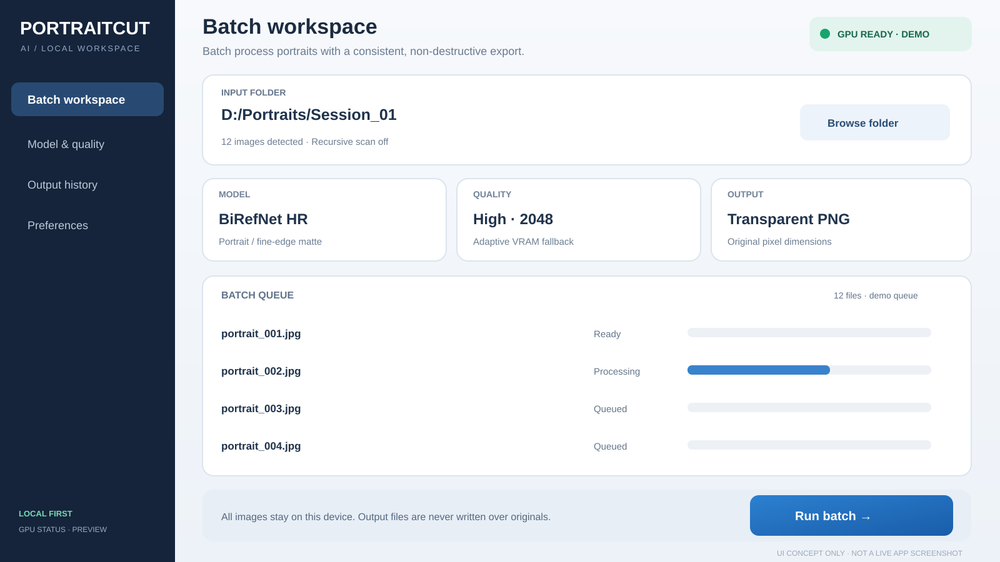
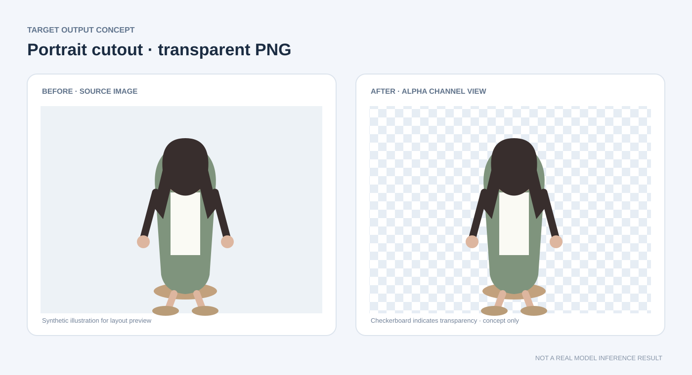
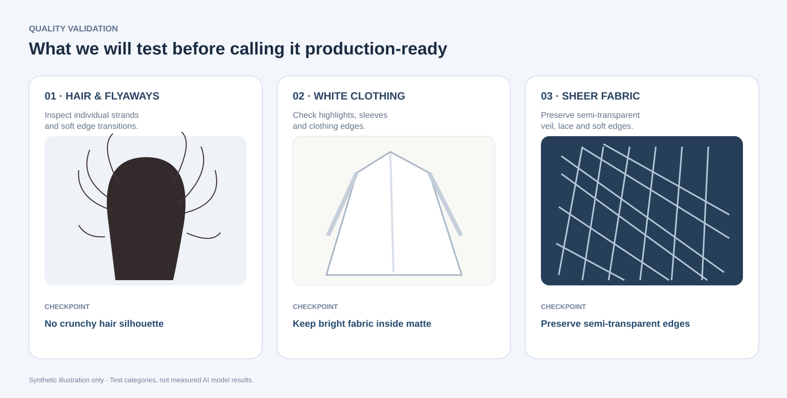

# PortraitCut AI

[English](README.md) · **简体中文**

**面向 Windows 和 NVIDIA 显卡的本地批量人物抠图桌面软件。**

> **当前状态：MVP Alpha。** 这是早期开发版本，不是 Photoshop 的完整替代品。CUDA 推理、真实人像的边缘质量和打包运行仍需在 Windows + RTX 4070 实机验证。

*这是界面概念图，不是当前运行程序的截图。*

## 功能

- 从文件夹批量导入图片，可选择递归扫描子文件夹。
- 使用固定版本的 BiRefNet-HR-matting 模型进行本地人像抠图。
- 优先使用 NVIDIA CUDA + FP16；显存不足时逐级降低模型输入尺寸重试。
- 保留原图 RGB，将预测的 Alpha 蒙版合成为透明 PNG。
- 单张顺序推理，降低显存占用；单张失败不会中断剩余任务。
- 自动处理输出重名，显示批处理进度。

## 效果示意

*合成插画，用于说明透明 PNG 的目标形式，不是 AI 模型实测结果。*

*示意后续需要验证的场景：碎发、浅色背景上的白色衣服、薄纱等半透明材质。这些不是模型实测结果。*

## 当前兼容版本基线

| 组件 | 版本 / 目标 |
|---|---|
| 操作系统 | Windows 10/11 x64 |
| Python | 3.11 x64 |
| PyTorch / torchvision | 2.5.1 / 0.20.1 |
| CUDA runtime | PyTorch CUDA 12.1 wheel；仍需安装 NVIDIA 驱动 |
| Transformers | 5.0.0 |
| huggingface-hub | >=1.0.0,<2 |
| NumPy | 1.26.4 |

这些版本是当前 BiRefNet 适配器采用的兼容基线，并不表示它们是最新版本。更改环境前请先查看 `requirements*.txt`。

模型适配器通过 `trust_remote_code=True` 加载模型仓库，并固定模型代码 revision：`5d6b6f8adcb5b417c871b1d84ceaae9871355b7f`。这意味着程序会在本机执行该上游版本中的 Python 代码。首次使用前请审阅对应的固定版本。

参考资料：[BiRefNet-HR 模型页](https://huggingface.co/ZhengPeng7/BiRefNet_HR-matting) · [固定模型代码版本](https://huggingface.co/ZhengPeng7/BiRefNet_HR-matting/tree/5d6b6f8adcb5b417c871b1d84ceaae9871355b7f) · [PyTorch 官方安装选择器](https://pytorch.org/get-started/locally/)

## Windows 安装与启动

1. 安装 64 位 Python 3.11 和较新的 NVIDIA 显卡驱动。
2. 在仓库根目录打开 PowerShell，执行：

~~~powershell
Set-ExecutionPolicy -Scope Process Bypass
.\scripts\install_windows.ps1
~~~

3. 启动程序：

~~~powershell
.\.venv\Scripts\python.exe -m app.main
~~~

4. 检查 CUDA 是否可用：

~~~powershell
.\.venv\Scripts\python.exe scripts\verify_gpu.py
~~~

首次加载模型需要联网下载模型文件。模型缓存完成后，图片推理在本机运行。

## 构建 Windows 独立运行目录

在 Windows 环境执行 `scripts/build_windows.ps1`。输出目录为 `dist/PortraitCutAI/`，分发时需要保留完整文件夹。应用和 Python 库会被打包，但目标电脑仍需 NVIDIA 驱动，模型文件也会在首次运行时下载。因此当前还不是完全离线安装包。

## 批量任务保护

- 单张图片最大 **5000 万像素**。
- 单批最多扫描 **10,000 张图片**。
- 每次只推理一张图片。
- 不覆盖已存在的输出文件；重名时自动增加后缀。
- 取消任务会在当前图片处理完成后生效。
- 这些是软件保护上限，不代表已经测得的性能或吞吐量保证。

## 测试

~~~powershell
.\.venv\Scripts\python.exe -m pip install -r requirements-dev.txt
.\.venv\Scripts\python.exe -m pytest -q
~~~

CI 测试覆盖的是可在 CPU 环境执行的代码路径。CI 通过不代表 CUDA 性能、所有类型图片的抠图质量或每台电脑上的打包运行都已验证。

## 仓库结构

~~~text
app/          桌面程序、批处理流程和模型适配器
scripts/      Windows 安装、GPU 检查和打包脚本
tests/        CPU-safe 回归测试
docs/         界面与质量验证概念图
models/       模型下载和许可证说明（不提交模型权重）
~~~

另行提供的白底 JavaScript 工具目前不在本仓库中，也未接入当前桌面程序。

## 隐私说明

PortraitCut AI 在用户自己的设备上执行图片推理。当前应用代码没有实现图片上传服务或远程推理接口。首次使用时，程序会连接 Hugging Face 下载模型文件；下载后模型文件缓存在本机。

模型适配器会在本机执行固定版本的上游模型代码。处理敏感素材前，请先审阅模型版本及第三方依赖。

## 安全问题报告

请勿在公开 Issue 中发布访问令牌、私人图片或其他敏感内容。漏洞报告方式请参见 [SECURITY.md](SECURITY.md)。

## 开源许可证

PortraitCut AI **原创项目代码采用 Apache License 2.0（Apache-2.0）**，详见 [LICENSE](LICENSE)。第三方模型代码、模型权重、Python 软件包和 Qt 组件分别保留各自的许可证，详见 [THIRD_PARTY_NOTICES.md](THIRD_PARTY_NOTICES.md)。

当前 PyInstaller 脚本仅用于开发打包，还不是完成第三方许可证合规审查的正式发布包。分发二进制文件前，需核对实际使用的 Qt 模块及其分发义务。另行提供的白底 JavaScript 工具不在本仓库中，也不受本项目许可证覆盖。
